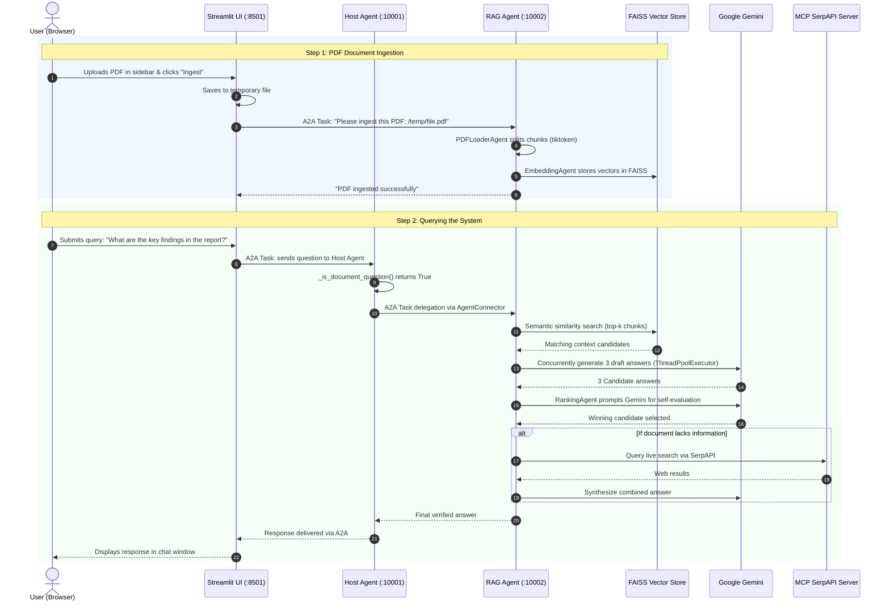

# MCPxA2AxAgentic-RAG: Architecture, Communication & Execution Guide

This document provides a complete, unified reference for the **MCPxA2AxAgentic-RAG** system. It covers how to run the project, how the backend is structured, how agents communicate with each other via the Agent-to-Agent (A2A) protocol, and the exact role played by the Streamlit user interface.

---

## 📑 Table of Contents
1. [System Overview](#1-system-overview)
2. [How to Run the Project](#2-how-to-run-the-project)
   - [Prerequisites & Environment](#prerequisites--environment)
   - [Starting the Backend Agents](#terminal-1-start-the-backend-agents)
   - [Starting the Streamlit UI](#terminal-2-start-the-streamlit-ui)
   - [Stopping the Services](#stopping-services--troubleshooting)
3. [Backend Architecture Deep Dive](#3-backend-architecture-deep-dive)
   - [System Entry Point (`main.py`)](#system-entry-point-mainpy)
   - [Host Agent (`agents/host_agent/`)](#host-agent-orchestrator-port-10001)
   - [Agentic RAG Agent (`agents/agentic_rag_agent/`)](#agentic-rag-agent-port-10002)
   - [RAG Internal Sub-Agent Pipeline](#rag-internal-sub-agent-pipeline)
   - [Model Context Protocol (MCP) Tools Layer](#model-context-protocol-mcp-tools-layer)
4. [Agent-to-Agent (A2A) Communication](#4-agent-to-agent-a2a-communication)
   - [Agent Discovery & `AgentCard`](#a-agent-discovery--agentcard)
   - [Task Delegation via `AgentConnector`](#b-task-delegation-via-agentconnector)
   - [End-to-End Sequence Diagram](#c-end-to-end-sequence-flow)
5. [The Role of Streamlit](#5-the-role-of-streamlit)
   - [What Streamlit Is (and Is Not)](#what-streamlit-is-and-is-not)
   - [Core Responsibilities](#core-responsibilities)

---

## 1. System Overview

The **MCPxA2AxAgentic-RAG** platform unites three modern autonomous AI paradigms into a cohesive system:

```
┌────────────────────────────────────────────────────────────────────────┐
│                        MCPxA2AxAgentic-RAG System                      │
├────────────────────────────────────────────────────────────────────────┤
│                                                                        │
│   Streamlit Web UI (Port 8501) ─── Frontend Client                     │
│               │                                                        │
│               ▼  (HTTP / A2A Protocol)                                 │
│   Host Agent (Port 10001) ◄──────────────► Agentic RAG (Port 10002)    │
│   • Central Orchestrator                   • Multi-Candidate RAG       │
│   • Intent Routing                         • HuggingFace + FAISS       │
│   • MCP Tool Hub                           • Gemini Answer Ranking     │
│               │                                     │                  │
│               ▼                                     ▼                  │
│   ┌──────────────────────────────────────────────────────────────┐     │
│   │                     MCP Tools Subprocesses                   │     │
│   │   • Web Search Server (SerpAPI)                              │     │
│   │   • Terminal Command Execution Server                        │     │
│   └──────────────────────────────────────────────────────────────┘     │
└────────────────────────────────────────────────────────────────────────┘
```

1. **Agent-to-Agent (A2A)**: Standardized HTTP protocol allowing independent agent microservices to expose capabilities and exchange tasks.
2. **Model Context Protocol (MCP)**: Standardized protocol developed by Anthropic allowing agents to communicate with external tool servers (Web Search, Terminal).
3. **Agentic RAG**: A multi-step retrieval-augmented generation engine that retrieves diverse chunk candidates, generates multiple parallel answers using Google Gemini, and uses an LLM-as-a-judge ranking step to pick the best verified response.

---

## 2. How to Run the Project

### Prerequisites & Environment

1. **Python Environment**: Dependencies are installed in the existing virtual environment at:
   ```
   C:\Users\shres\Desktop\proj\MCP_A2A\venv
   ```
2. **Environment Variables**: The project reads API keys from `.env` in the project root:
   ```env
   GOOGLE_API_KEY=your_google_api_key_here
   SERPAPI_KEY=your_serpapi_key_here
   ```

---

### Terminal 1: Start the Backend Agents

Open a PowerShell terminal and run:

```powershell
cd c:\Users\shres\Desktop\proj\MCP_A2A\langgraph-ai\agentic-rag\agentic-rag-systems\mcp_a2a_agentic_rag
..\..\..\..\venv\Scripts\Activate.ps1
python main.py
```

> [!NOTE]
> **What happens during startup:**
> - Spawns the **Host Agent** on `http://127.0.0.1:10001`.
> - Spawns the **Agentic RAG Agent** on `http://127.0.0.1:10002`.
> - Starts MCP child processes for SerpAPI web search and terminal commands.
> - Verifies listening ports and logs readiness.

---

### Terminal 2: Start the Streamlit UI

Open a second PowerShell terminal and run:

```powershell
cd c:\Users\shres\Desktop\proj\MCP_A2A\langgraph-ai\agentic-rag\agentic-rag-systems\mcp_a2a_agentic_rag
..\..\..\..\venv\Scripts\Activate.ps1
streamlit run app/streamlit_ui.py
```

Streamlit will launch automatically in your browser at `http://localhost:8501`.

---

### Stopping Services & Troubleshooting

- **Graceful Shutdown**: Press `Ctrl + C` in both terminal windows.
- **Port Conflicts**: If port `10001` or `10002` remains occupied, check running ports in PowerShell:
  ```powershell
  Get-NetTCPConnection -LocalPort 10001,10002 -ErrorAction SilentlyContinue
  ```
- **Harmless Warnings**: On Python 3.12 / 3.13, you may see occasional cancel scope warnings during shutdown from `anyio`/`asyncio`. These do not affect system operations.

---

## 3. Backend Architecture Deep Dive

```mermaid
classDiagram
    class MainRunner {
        +serve_host_agent()
        +serve_agentic_rag_agent()
    }
    class HostAgent {
        +AgentConnector connector
        +AgentDiscovery discovery
        +MCPConnector mcp
        +_delegate_task()
        +_smart_delegate_to_rag()
        +_is_document_question()
    }
    class AgenticRAGAgent {
        +RAGOrchestrator rag_orchestrator
        +_ingest_pdf()
        +_search_documents()
        +_get_system_status()
    }
    class RAGOrchestrator {
        +PDFLoaderAgent pdf_loader
        +EmbeddingAgent embedder
        +RetrievalAgent retriever
        +QAAgent qa_generator
        +RankingAgent ranker
        +WebSearchAgent web_search
    }

    MainRunner --> HostAgent : launches on :10001
    MainRunner --> AgenticRAGAgent : launches on :10002
    HostAgent --> AgenticRAGAgent : delegates via A2A HTTP
    AgenticRAGAgent --> RAGOrchestrator : executes pipeline
```

### System Entry Point (`main.py`)
- Sets thread safety flags (`OMP_NUM_THREADS=1`, `TOKENIZERS_PARALLELISM=false`) to prevent multi-threading segfaults between PyTorch and FAISS.
- Validates required API keys (`GOOGLE_API_KEY`, `SERPAPI_KEY`).
- Concurrently runs `serve_host_agent` and `serve_agentic_rag_agent` within a single asyncio event loop.

### Host Agent Orchestrator (Port 10001)
- **File**: `agents/host_agent/main.py` & `agents/host_agent/agent.py`
- Exposes an **`A2AStarletteApplication`** server.
- Built on top of Google ADK's `LlmAgent` using Gemini (`gemini-3.1-flash-lite`).
- **Core Tools**:
  - `_delegate_task(agent_name, message)`: General A2A delegation.
  - `_smart_delegate_to_rag(question)`: Intercepts document-related queries and routes them directly to `agentic_rag_agent`.
  - `_list_agents()`: Queries the discovery registry to identify available child agents.
  - Dynamically bound MCP tools (web search, terminal execution).

### Agentic RAG Agent (Port 10002)
- **File**: `agents/agentic_rag_agent/main.py` & `agents/agentic_rag_agent/agent.py`
- Exposes its own **`A2AStarletteApplication`** on port 10002.
- Houses the document index, vector store, and document question-answering logic.

### RAG Internal Sub-Agent Pipeline
Inside `agents/agentic_rag_agent/rag_orchestrator.py`, the RAG agent coordinates a 6-stage sub-agent pipeline:

1. **`PDFLoaderAgent`**: Extracts raw text with `PyPDF2` and splits text into chunks using `tiktoken` (cl100k_base, chunk size 500 tokens, 50 token overlap).
2. **`EmbeddingAgent`**: Converts text chunks into 384-dimensional dense vectors using HuggingFace / Google Safe embeddings (`sentence-transformers/all-MiniLM-L6-v2` or `nomic-embed-text`).
3. **`RetrievalAgent`**: Maintains an in-memory `faiss.IndexFlatL2` vector store. Implements diverse candidate retrieval to select multiple distinct chunk sets.
4. **`QAAgent`**: Uses `concurrent.futures.ThreadPoolExecutor` to call Gemini simultaneously for each candidate context, producing 3 diverse draft answers.
5. **`RankingAgent`**: Prompts Gemini with a self-evaluation rubric to judge completeness, groundedness, and accuracy among candidate answers, outputting the best verified response.
6. **`WebSearchAgent`**: If the document lacks sufficient context, it triggers SerpAPI web search through MCP to augment the response with real-time web knowledge.

### Model Context Protocol (MCP) Tools Layer
- **Config**: `mcp_config.json`
- **Connector**: `utilities/mcp/mcp_connect.py`
- Uses Anthropic's MCP Python SDK (`StdioServerParameters`) to spawn independent child processes:
  - `mcp/servers/web_search_server/web_search_server.py`: Real-time Google search via SerpAPI.
  - `mcp/servers/terminal_server/terminal_server.py`: Safe command and filesystem inspection.
- The tools returned by these servers are automatically wrapped into Google ADK `FunctionTool` objects and provided to the LLM agents.

---

## 4. Agent-to-Agent (A2A) Communication

The system relies on the **A2A protocol** (via `a2a-sdk`), a standardized communication layer over HTTP:

### A. Agent Discovery & `AgentCard`

Every agent in the system generates an `AgentCard`:
```json
{
  "name": "agentic_rag_agent",
  "url": "http://127.0.0.1:10002/",
  "version": "1.0.0",
  "defaultInputModes": ["text", "file"],
  "defaultOutputModes": ["text"],
  "skills": [
    {
      "id": "agentic_rag_skill",
      "name": "agentic_rag_skill",
      "description": "Advanced document processing and question answering using agentic RAG..."
    }
  ],
  "capabilities": { "streaming": true }
}
```

- When an agent server starts, it publishes this card at `GET /.well-known/agent.json`.
- The Host Agent reads `utilities/a2a/agent_registry.json` (which contains `["http://127.0.0.1:10002"]`).
- `AgentDiscovery` queries `/.well-known/agent.json` using `A2ACardResolver` to learn what the RAG agent can do and where it lives.

### B. Task Delegation via `AgentConnector`

When an agent needs another agent to complete a task:
1. It uses `AgentConnector(agent_card)`.
2. It calls `await connector.send_task(message, session_id)`.
3. `a2a-sdk`'s `ClientFactory.connect` establishes an HTTP connection to the destination agent's Starlette endpoint.
4. The destination agent processes the message in its `DefaultRequestHandler` and streams back the result as A2A task events.

### C. End-to-End Sequence Flow



---

## 5. The Role of Streamlit

[`app/streamlit_ui.py`](file:///c:/Users/shres/Desktop/proj/MCP_A2A/langgraph-ai/agentic-rag/agentic-rag-systems/mcp_a2a_agentic_rag/app/streamlit_ui.py) is strictly a **frontend client presentation layer**.

### What Streamlit Is (and Is Not)

- ❌ **It is NOT the backend**: Streamlit does not run LLMs, does not compute embeddings, does not perform vector searches, and does not execute MCP tools.
- ✅ **It IS an A2A Client**: Streamlit acts like an API consumer. It imports `AgentConnector` and `A2ACardResolver` to interact with the backend agent microservices exactly like any external client would.

### Core Responsibilities

1. **A2A Client Router**:
   - Allows the user to select which agent to talk to directly via the sidebar dropdown:
     - **Host Orchestrator (`:10001`)**: For general queries, task orchestration, and automated delegation.
     - **Agentic RAG Agent (`:10002`)**: For direct document querying without the Host intermediary.

2. **File Ingestion Bridge**:
   - Receives the uploaded PDF from the browser.
   - Writes the file to a temporary location (`tempfile.NamedTemporaryFile`).
   - Dispatches an A2A command (`Please ingest this PDF: <temp_path>`) to the RAG Agent on port `10002`.
   - Cleans up the temporary file upon completion.

3. **Session State & Chat Interface**:
   - Manages user session state (`session_id = uuid4().hex`).
   - Maintains conversation history across reruns (`st.session_state.chat_history`).
   - Displays real-time loading spinners while parallel candidate generation and ranking occur.
   - Provides status inspection buttons (e.g., checking RAG system health and loaded document count).

---

## 6. Summary Comparison Table

| Component | Port / Interface | Primary Responsibility | Key Libraries / Protocols |
| :--- | :--- | :--- | :--- |
| **Streamlit UI** | `http://localhost:8501` | User interface, PDF upload bridge, session chat | Streamlit, `httpx`, `a2a-sdk` |
| **Host Agent** | `http://127.0.0.1:10001` | Master orchestration, query routing, MCP integration | Google ADK, Starlette, Uvicorn, A2A |
| **Agentic RAG Agent** | `http://127.0.0.1:10002` | Document Q&A, multi-candidate ranking, FAISS indexing | FAISS, HuggingFace, PyPDF2, Gemini, A2A |
| **MCP Servers** | Stdio (child processes) | Tool execution (live search, terminal) | MCP SDK, SerpAPI |
