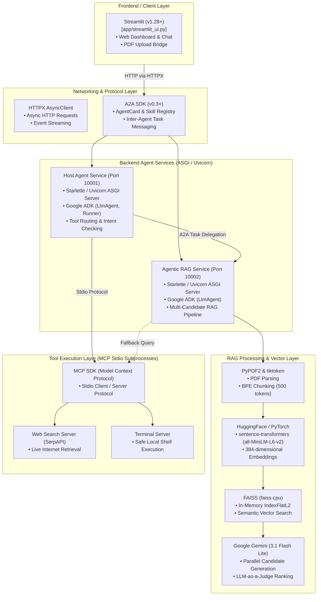

# MCPxA2AxAgentic-RAG: Complete Technology Stack Guide

This document provides a comprehensive breakdown of the entire technology stack used in the **MCPxA2AxAgentic-RAG** project. It details each library and framework, its specific role, exact file locations, and how it is implemented and wired into the system.

---

## 📑 Table of Contents
1. [Tech Stack Architecture Diagram](#1-tech-stack-architecture-diagram)
2. [Agent Orchestration & Protocol Frameworks](#2-agent-orchestration--protocol-frameworks)
   - [Google ADK & `google-genai`](#a-google-adk-agent-development-kit--google-genai)
   - [A2A SDK (`a2a-sdk`)](#b-a2a-sdk-agent-to-agent-protocol)
   - [Model Context Protocol (`mcp`)](#c-model-context-protocol-mcp)
3. [LLMs & Embedding Models](#3-llms--embedding-models)
   - [Google Gemini (`langchain-google-genai`)](#a-google-gemini)
   - [HuggingFace Embeddings (`sentence-transformers`, `torch`)](#b-huggingface-embeddings--pytorch)
4. [Vector Database & Document Processing](#4-vector-database--document-processing)
   - [FAISS (`faiss-cpu`)](#a-faiss-facebook-ai-similarity-search)
   - [`tiktoken` & `PyPDF2`](#b-tiktoken--pypdf2)
5. [Backend Web Servers & Networking](#5-backend-web-servers--networking)
   - [Starlette & FastAPI](#a-starlette--fastapi)
   - [Uvicorn](#b-uvicorn)
   - [HTTPX](#c-httpx)
6. [Frontend Presentation Layer](#6-frontend-presentation-layer)
   - [Streamlit](#a-streamlit)
7. [Configuration & Utility Libraries](#7-configuration--utility-libraries)
8. [Complete Technology Summary Table](#8-complete-technology-summary-table)

---

## 1. Tech Stack Architecture Diagram

---

## 2. Agent Orchestration & Protocol Frameworks

### A. Google ADK (Agent Development Kit) & `google-genai`
- **What it is**: Google's official framework for building stateful, autonomous AI agents with memory, artifact storage, and tool integration.
- **Where it is used**:
  - [`agents/host_agent/agent.py`](file:///c:/Users/shres/Desktop/proj/MCP_A2A/langgraph-ai/agentic-rag/agentic-rag-systems/mcp_a2a_agentic_rag/agents/host_agent/agent.py#L8-L14)
  - [`agents/agentic_rag_agent/agent.py`](file:///c:/Users/shres/Desktop/proj/MCP_A2A/langgraph-ai/agentic-rag/agentic-rag-systems/mcp_a2a_agentic_rag/agents/agentic_rag_agent/agent.py#L7-L13)
- **How it is used**:
  - **Agent Runtime**: Instantiates [`LlmAgent`](file:///c:/Users/shres/Desktop/proj/MCP_A2A/langgraph-ai/agentic-rag/agentic-rag-systems/mcp_a2a_agentic_rag/agents/host_agent/agent.py#L140) with custom instructions and bound tools.
  - **Execution Manager**: Uses `Runner` to execute agent turns alongside `InMemorySessionService`, `InMemoryMemoryService`, and `InMemoryArtifactService`.
  - **Tool Binding**: Wraps custom Python methods (like delegation and model info) into `FunctionTool` objects so the LLM can invoke them.

### B. A2A SDK (`a2a-sdk`)
- **What it is**: The standardized **Agent-to-Agent protocol** library facilitating discovery, capability negotiation, and task delegation among autonomous agent microservices.
- **Where it is used**:
  - Server endpoints: [`agents/host_agent/main.py`](file:///c:/Users/shres/Desktop/proj/MCP_A2A/langgraph-ai/agentic-rag/agentic-rag-systems/mcp_a2a_agentic_rag/agents/host_agent/main.py#L3-L8), [`agents/agentic_rag_agent/main.py`](file:///c:/Users/shres/Desktop/proj/MCP_A2A/langgraph-ai/agentic-rag/agentic-rag-systems/mcp_a2a_agentic_rag/agents/agentic_rag_agent/main.py#L3-L8)
  - Client connections: [`utilities/a2a/agent_connect.py`](file:///c:/Users/shres/Desktop/proj/MCP_A2A/langgraph-ai/agentic-rag/agentic-rag-systems/mcp_a2a_agentic_rag/utilities/a2a/agent_connect.py#L3-L5)
  - Registry discovery: [`utilities/a2a/agent_discovery.py`](file:///c:/Users/shres/Desktop/proj/MCP_A2A/langgraph-ai/agentic-rag/agentic-rag-systems/mcp_a2a_agentic_rag/utilities/a2a/agent_discovery.py#L3-L7)
  - Streamlit client: [`app/streamlit_ui.py`](file:///c:/Users/shres/Desktop/proj/MCP_A2A/langgraph-ai/agentic-rag/agentic-rag-systems/mcp_a2a_agentic_rag/app/streamlit_ui.py#L15-L16)
- **How it is used**:
  - **AgentCard**: Each agent defines an `AgentCard` describing its name, skills, and endpoints, exposed at `GET /.well-known/agent.json`.
  - **Discovery**: Reads [`agent_registry.json`](file:///c:/Users/shres/Desktop/proj/MCP_A2A/langgraph-ai/agentic-rag/agentic-rag-systems/mcp_a2a_agentic_rag/utilities/a2a/agent_registry.json) using `A2ACardResolver` to locate and resolve the endpoints of other agents.
  - **Task Messaging**: `AgentConnector` uses `ClientFactory.connect` to send streaming messages (`create_text_message_object`) and receive real-time status updates across HTTP.

### C. Model Context Protocol (`mcp`)
- **What it is**: An open standard developed by Anthropic allowing LLMs to securely execute tools hosted on isolated subprocesses via standard input/output (stdio).
- **Where it is used**:
  - Connector: [`utilities/mcp/mcp_connect.py`](file:///c:/Users/shres/Desktop/proj/MCP_A2A/langgraph-ai/agentic-rag/agentic-rag-systems/mcp_a2a_agentic_rag/utilities/mcp/mcp_connect.py)
  - Configuration: [`mcp_config.json`](file:///c:/Users/shres/Desktop/proj/MCP_A2A/langgraph-ai/agentic-rag/agentic-rag-systems/mcp_a2a_agentic_rag/mcp_config.json)
  - Servers: [`mcp/servers/web_search_server/`](file:///c:/Users/shres/Desktop/proj/MCP_A2A/langgraph-ai/agentic-rag/agentic-rag-systems/mcp_a2a_agentic_rag/mcp/servers/web_search_server/) and [`mcp/servers/terminal_server/`](file:///c:/Users/shres/Desktop/proj/MCP_A2A/langgraph-ai/agentic-rag/agentic-rag-systems/mcp_a2a_agentic_rag/mcp/servers/terminal_server/)
- **How it is used**:
  - Reads `mcp_config.json` to identify executable tool servers.
  - Automatically spins up Python subprocesses over stdio pipes using `StdioServerParameters`.
  - Converts discovered MCP tools into Google ADK-compatible `MCPToolset` instances and attaches them directly to the Host Agent.

---

## 3. LLMs & Embedding Models

### A. Google Gemini
- **Libraries**: `langchain-google-genai`, `google-genai`
- **What it is**: The primary foundation model powering agent reasoning, decision-making, and answer generation.
- **Where it is used**:
  - Model definitions: [`model.py`](file:///c:/Users/shres/Desktop/proj/MCP_A2A/langgraph-ai/agentic-rag/agentic-rag-systems/mcp_a2a_agentic_rag/model.py#L52-L65)
  - Generation & Ranking: [`rag_orchestrator.py`](file:///c:/Users/shres/Desktop/proj/MCP_A2A/langgraph-ai/agentic-rag/agentic-rag-systems/mcp_a2a_agentic_rag/agents/agentic_rag_agent/rag_orchestrator.py#L182-L300)
- **How it is used**:
  - Connects to Google's API using `ChatGoogleGenerativeAI(model="gemini-3.1-flash-lite")`.
  - **Host Agent Reasoning**: Determines user intent and decides whether to route questions to the RAG Agent or invoke web search.
  - **Parallel RAG Generation**: In [`QAAgent`](file:///c:/Users/shres/Desktop/proj/MCP_A2A/langgraph-ai/agentic-rag/agentic-rag-systems/mcp_a2a_agentic_rag/agents/agentic_rag_agent/rag_orchestrator.py#L182), concurrent worker threads prompt Gemini to draft 3 diverse candidate responses from different context sets.
  - **LLM-as-a-Judge**: In [`RankingAgent`](file:///c:/Users/shres/Desktop/proj/MCP_A2A/langgraph-ai/agentic-rag/agentic-rag-systems/mcp_a2a_agentic_rag/agents/agentic_rag_agent/rag_orchestrator.py#L248), Gemini evaluates all 3 generated candidates against strict accuracy rubrics and selects the winning response.

### B. HuggingFace Embeddings & PyTorch
- **Libraries**: `sentence-transformers`, `transformers`, `torch`, `langchain-huggingface`
- **What it is**: Deep learning embedding framework running locally to convert text chunks into vector embeddings.
- **Where it is used**:
  - Model configuration: [`model.py`](file:///c:/Users/shres/Desktop/proj/MCP_A2A/langgraph-ai/agentic-rag/agentic-rag-systems/mcp_a2a_agentic_rag/model.py#L90-L125)
  - Embedding pipeline: [`EmbeddingAgent`](file:///c:/Users/shres/Desktop/proj/MCP_A2A/langgraph-ai/agentic-rag/agentic-rag-systems/mcp_a2a_agentic_rag/agents/agentic_rag_agent/rag_orchestrator.py#L71)
- **How it is used**:
  - Loads `sentence-transformers/all-MiniLM-L6-v2` (or `nomic-ai/nomic-embed-text-v1.5`).
  - Encodes document chunks and search queries into dense 384-dimensional floating-point vectors.

---

## 4. Vector Database & Document Processing

### A. FAISS (Facebook AI Similarity Search)
- **Library**: `faiss-cpu`
- **What it is**: High-performance, low-latency in-memory vector database and similarity search library.
- **Where it is used**:
  - [`agents/agentic_rag_agent/rag_orchestrator.py`](file:///c:/Users/shres/Desktop/proj/MCP_A2A/langgraph-ai/agentic-rag/agentic-rag-systems/mcp_a2a_agentic_rag/agents/agentic_rag_agent/rag_orchestrator.py#L17)
- **How it is used**:
  - Initializes an exact L2 distance index via `faiss.IndexFlatL2(384)`.
  - Stores document chunk vectors with `index.add(vectors)`.
  - Performs nearest-neighbor similarity search using `index.search(query_vector, k)` to retrieve top matching chunks.

### B. `tiktoken` & `PyPDF2`
- **What it is**: Byte-Pair Encoding (BPE) tokenizer and PDF parsing library.
- **Where it is used**:
  - [`PDFLoaderAgent`](file:///c:/Users/shres/Desktop/proj/MCP_A2A/langgraph-ai/agentic-rag/agentic-rag-systems/mcp_a2a_agentic_rag/agents/agentic_rag_agent/rag_orchestrator.py#L47-L70)
- **How it is used**:
  - `PyPDF2.PdfReader` extracts raw text from PDF files.
  - `tiktoken.get_encoding("cl100k_base")` splits text into clean 500-token chunks with 50-token sliding overlaps to preserve semantic context across chunk boundaries.

---

## 5. Backend Web Servers & Networking

### A. Starlette & FastAPI
- **Libraries**: `starlette`, `fastapi`
- **What it is**: Asynchronous ASGI web framework providing routing and request handling.
- **Where it is used**:
  - [`agents/host_agent/main.py`](file:///c:/Users/shres/Desktop/proj/MCP_A2A/langgraph-ai/agentic-rag/agentic-rag-systems/mcp_a2a_agentic_rag/agents/host_agent/main.py#L8)
  - [`agents/agentic_rag_agent/main.py`](file:///c:/Users/shres/Desktop/proj/MCP_A2A/langgraph-ai/agentic-rag/agentic-rag-systems/mcp_a2a_agentic_rag/agents/agentic_rag_agent/main.py#L7)
- **How it is used**:
  - Built by `A2AStarletteApplication` to serve the A2A endpoints, JSON-RPC communication handlers, and `/health` monitoring routes.

### B. Uvicorn
- **Library**: `uvicorn`
- **What it is**: High-performance ASGI web server.
- **Where it is used**:
  - Runs in the background of both agent microservices to listen on ports:
    - Host Agent: `http://127.0.0.1:10001`
    - RAG Agent: `http://127.0.0.1:10002`

### C. HTTPX
- **Library**: `httpx`
- **What it is**: Asynchronous HTTP client library for Python.
- **Where it is used**:
  - Inter-agent HTTP calls: [`utilities/a2a/agent_discovery.py`](file:///c:/Users/shres/Desktop/proj/MCP_A2A/langgraph-ai/agentic-rag/agentic-rag-systems/mcp_a2a_agentic_rag/utilities/a2a/agent_discovery.py#L9), [`utilities/a2a/agent_connect.py`](file:///c:/Users/shres/Desktop/proj/MCP_A2A/langgraph-ai/agentic-rag/agentic-rag-systems/mcp_a2a_agentic_rag/utilities/a2a/agent_connect.py#L2)
  - UI client: [`app/streamlit_ui.py`](file:///c:/Users/shres/Desktop/proj/MCP_A2A/langgraph-ai/agentic-rag/agentic-rag-systems/mcp_a2a_agentic_rag/app/streamlit_ui.py#L17)
- **How it is used**:
  - Dispatches async POST requests and event streams to send tasks and receive answers with a configured 300-second timeout.

---

## 6. Frontend Presentation Layer

### A. Streamlit
- **Library**: `streamlit`
- **What it is**: Fast Python web framework for data and AI user interfaces.
- **Where it is used**:
  - [`app/streamlit_ui.py`](file:///c:/Users/shres/Desktop/proj/MCP_A2A/langgraph-ai/agentic-rag/agentic-rag-systems/mcp_a2a_agentic_rag/app/streamlit_ui.py)
- **How it is used**:
  - **A2A Client**: Connects as a client to the backend agents via `AgentConnector`.
  - **Chat UI**: Displays conversation messages and interactive loading spinners.
  - **PDF Ingestion Bridge**: Saves uploaded PDFs to disk and dispatches an A2A ingestion command directly to port `10002`.

---

## 7. Configuration & Utility Libraries

| Library | Primary Use in this Project | Location |
| :--- | :--- | :--- |
| **`python-dotenv`** | Loads API keys (`GOOGLE_API_KEY`, `SERPAPI_KEY`) from `.env` file | [`main.py`](file:///c:/Users/shres/Desktop/proj/MCP_A2A/langgraph-ai/agentic-rag/agentic-rag-systems/mcp_a2a_agentic_rag/main.py#L10), [`model.py`](file:///c:/Users/shres/Desktop/proj/MCP_A2A/langgraph-ai/agentic-rag/agentic-rag-systems/mcp_a2a_agentic_rag/model.py#L22) |
| **`pydantic`** | Validates data schemas, AgentCard definitions, and tool arguments | `a2a.types`, [`agents/host_agent/agent.py`](file:///c:/Users/shres/Desktop/proj/MCP_A2A/langgraph-ai/agentic-rag/agentic-rag-systems/mcp_a2a_agentic_rag/agents/host_agent/agent.py) |
| **`rich`** | Renders formatted, colored console logs for tool discovery and server startup | [`utilities/mcp/mcp_connect.py`](file:///c:/Users/shres/Desktop/proj/MCP_A2A/langgraph-ai/agentic-rag/agentic-rag-systems/mcp_a2a_agentic_rag/utilities/mcp/mcp_connect.py#L8) |
| **`numpy`** | Formats dense vector arrays to `float32` for FAISS indexing | [`rag_orchestrator.py`](file:///c:/Users/shres/Desktop/proj/MCP_A2A/langgraph-ai/agentic-rag/agentic-rag-systems/mcp_a2a_agentic_rag/agents/agentic_rag_agent/rag_orchestrator.py#L23) |
| **`aiofiles`** | Asynchronous local file reading and writing | `requirements.txt` |
| **`beautifulsoup4`** | HTML parsing and content sanitization for web search tools | `requirements.txt` |

---

## 8. Complete Technology Summary Table

| Category | Component / Library | Role in Project | Implementation File(s) |
| :--- | :--- | :--- | :--- |
| **Agent Framework** | `google-adk`, `google-genai` | Agent runtime, memory, runner, and function tools | [`agents/host_agent/agent.py`](file:///c:/Users/shres/Desktop/proj/MCP_A2A/langgraph-ai/agentic-rag/agentic-rag-systems/mcp_a2a_agentic_rag/agents/host_agent/agent.py), [`agents/agentic_rag_agent/agent.py`](file:///c:/Users/shres/Desktop/proj/MCP_A2A/langgraph-ai/agentic-rag/agentic-rag-systems/mcp_a2a_agentic_rag/agents/agentic_rag_agent/agent.py) |
| **Agent Protocol** | `a2a-sdk` | AgentCard registry, discovery, and inter-agent HTTP messaging | [`utilities/a2a/`](file:///c:/Users/shres/Desktop/proj/MCP_A2A/langgraph-ai/agentic-rag/agentic-rag-systems/mcp_a2a_agentic_rag/utilities/a2a/), [`agents/host_agent/main.py`](file:///c:/Users/shres/Desktop/proj/MCP_A2A/langgraph-ai/agentic-rag/agentic-rag-systems/mcp_a2a_agentic_rag/agents/host_agent/main.py) |
| **Tool Protocol** | `mcp` | Model Context Protocol subprocess tool execution (SerpAPI, terminal) | [`utilities/mcp/`](file:///c:/Users/shres/Desktop/proj/MCP_A2A/langgraph-ai/agentic-rag/agentic-rag-systems/mcp_a2a_agentic_rag/utilities/mcp/), [`mcp/servers/`](file:///c:/Users/shres/Desktop/proj/MCP_A2A/langgraph-ai/agentic-rag/agentic-rag-systems/mcp_a2a_agentic_rag/mcp/servers/) |
| **Foundation LLM** | `langchain-google-genai` | Gemini 3.1 Flash Lite reasoning, generation, and answer ranking | [`model.py`](file:///c:/Users/shres/Desktop/proj/MCP_A2A/langgraph-ai/agentic-rag/agentic-rag-systems/mcp_a2a_agentic_rag/model.py), [`agents/agentic_rag_agent/rag_orchestrator.py`](file:///c:/Users/shres/Desktop/proj/MCP_A2A/langgraph-ai/agentic-rag/agentic-rag-systems/mcp_a2a_agentic_rag/agents/agentic_rag_agent/rag_orchestrator.py) |
| **Embedding Engine**| `sentence-transformers`, `torch` | Local 384-d vector embeddings generation | [`model.py`](file:///c:/Users/shres/Desktop/proj/MCP_A2A/langgraph-ai/agentic-rag/agentic-rag-systems/mcp_a2a_agentic_rag/model.py), [`rag_orchestrator.py`](file:///c:/Users/shres/Desktop/proj/MCP_A2A/langgraph-ai/agentic-rag/agentic-rag-systems/mcp_a2a_agentic_rag/agents/agentic_rag_agent/rag_orchestrator.py) |
| **Vector Store** | `faiss-cpu` | In-memory L2 distance nearest-neighbor similarity indexing | [`agents/agentic_rag_agent/rag_orchestrator.py`](file:///c:/Users/shres/Desktop/proj/MCP_A2A/langgraph-ai/agentic-rag/agentic-rag-systems/mcp_a2a_agentic_rag/agents/agentic_rag_agent/rag_orchestrator.py) |
| **Tokenization** | `tiktoken` | BPE text chunking (500 tokens, 50 token overlap) | [`agents/agentic_rag_agent/rag_orchestrator.py`](file:///c:/Users/shres/Desktop/proj/MCP_A2A/langgraph-ai/agentic-rag/agentic-rag-systems/mcp_a2a_agentic_rag/agents/agentic_rag_agent/rag_orchestrator.py) |
| **Document Parser**| `PyPDF2` | Extracts text from uploaded PDF documents | [`agents/agentic_rag_agent/rag_orchestrator.py`](file:///c:/Users/shres/Desktop/proj/MCP_A2A/langgraph-ai/agentic-rag/agentic-rag-systems/mcp_a2a_agentic_rag/agents/agentic_rag_agent/rag_orchestrator.py) |
| **Server Framework**| `starlette`, `fastapi`, `uvicorn` | ASGI web servers on ports `10001` and `10002` | [`agents/host_agent/main.py`](file:///c:/Users/shres/Desktop/proj/MCP_A2A/langgraph-ai/agentic-rag/agentic-rag-systems/mcp_a2a_agentic_rag/agents/host_agent/main.py), [`agents/agentic_rag_agent/main.py`](file:///c:/Users/shres/Desktop/proj/MCP_A2A/langgraph-ai/agentic-rag/agentic-rag-systems/mcp_a2a_agentic_rag/agents/agentic_rag_agent/main.py) |
| **HTTP Client** | `httpx` | Async client for inter-agent networking and UI communication | [`utilities/a2a/`](file:///c:/Users/shres/Desktop/proj/MCP_A2A/langgraph-ai/agentic-rag/agentic-rag-systems/mcp_a2a_agentic_rag/utilities/a2a/), [`app/streamlit_ui.py`](file:///c:/Users/shres/Desktop/proj/MCP_A2A/langgraph-ai/agentic-rag/agentic-rag-systems/mcp_a2a_agentic_rag/app/streamlit_ui.py) |
| **Frontend UI** | `streamlit` | Interactive browser dashboard, chat interface, PDF upload | [`app/streamlit_ui.py`](file:///c:/Users/shres/Desktop/proj/MCP_A2A/langgraph-ai/agentic-rag/agentic-rag-systems/mcp_a2a_agentic_rag/app/streamlit_ui.py) |
