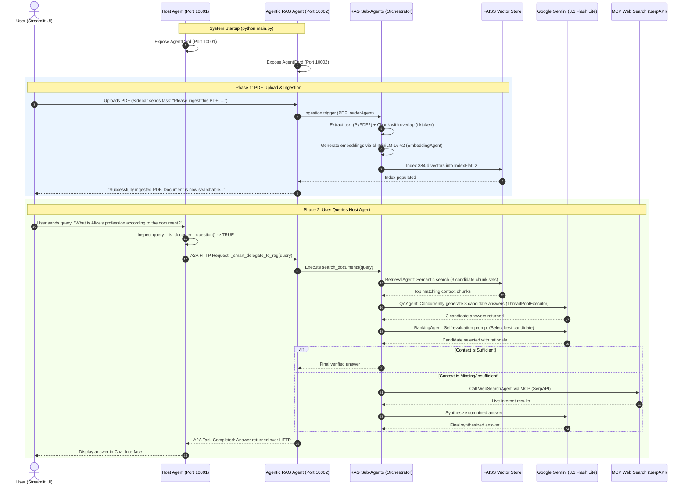

# Complete End-to-End System Flow: Host Agent & PDF Ingestion

This document walks you through the step-by-step lifecycle of the system when you start the project, select the **Host Agent**, upload a PDF, and ask questions.

---

## 1. High-Level Architecture Diagram



---

## 2. Phase-by-Phase Detailed Walkthrough

### Phase 1: Starting the Project

1. **Terminal Command**:
   ```powershell
   python main.py
   ```
2. **What Happens**:
   - `main.py` loads environment variables (`GOOGLE_API_KEY`, `SERPAPI_KEY`) from `.env`.
   - Starts **Host Agent** on `http://127.0.0.1:10001` (ASGI / Uvicorn).
   - Starts **Agentic RAG Agent** on `http://127.0.0.1:10002` (ASGI / Uvicorn).
   - Both agents publish their discovery **Agent Card** at `/.well-known/agent-card.json`.
   - MCP Subprocesses (`web_search_server.py`, `terminal_server.py`) initialize via stdio JSON-RPC.

3. **User Launches UI**:
   ```powershell
   streamlit run app/streamlit_ui.py
   ```
   - In the sidebar dropdown, the user selects: **"Host Agent"** (`http://127.0.0.1:10001`).

---

### Phase 2: Uploading and Ingesting the PDF

1. **User Action**:
   - In the Streamlit sidebar under **Document Upload**, the user selects a PDF (e.g. `sample_document.pdf`) and clicks **"Ingest PDF"**.

2. **Under the Hood (`app/streamlit_ui.py`)**:
   - Streamlit saves the uploaded bytes to a local temporary file (`temp_path`).
   - Even though **Host Agent** is active in the chat dropdown, Streamlit knows that document ingestion is a specialist capability of the RAG Agent.
   - Streamlit connects to `http://127.0.0.1:10002` (RAG Agent) and sends:
     ```python
     message = f"Please ingest this PDF: {temp_path}"
     ```

3. **Inside the RAG Agent (`rag_orchestrator.py`)**:
   - **`PDFLoaderAgent`**:
     - Reads the PDF pages using `PyPDF2.PdfReader`.
     - Extracts the raw text and calculates token lengths with `tiktoken` (`cl100k_base`).
     - Splits text into semantic chunks with a 10% overlap to preserve cross-boundary context.
   - **`EmbeddingAgent`**:
     - Runs the local model `sentence-transformers/all-MiniLM-L6-v2`.
     - Generates 384-dimensional dense vectors for each chunk locally on CPU.
   - **FAISS Vector Index**:
     - Initializes or appends the vectors into an in-memory `faiss.IndexFlatL2`.
   - **Confirmation**:
     - The RAG Agent marks task state as `completed` and returns:
       > `"Successfully ingested PDF: ... Document is now searchable using HuggingFace Transformers embeddings."`
   - Streamlit updates the UI sidebar: `RAG Ready: ✅ Yes`.

---

### Phase 3: Asking a Question to the Host Agent

1. **User Action**:
   - In the chat input, the user types:
     > *"What is Alice's profession according to the document?"*

2. **Host Agent Ingestion & Intent Detection (`agents/host_agent/agent.py`)**:
   - The message reaches the Host Agent at `http://127.0.0.1:10001`.
   - The Host Agent runs its intent detector:
     ```python
     def _is_document_question(self, query: str) -> bool:
         # Checks for keywords: 'document', 'pdf', 'resume', 'according to', etc.
     ```
   - Because the query contains document-specific intent, the Host Agent intercepts it and triggers **Smart Delegation**.

3. **A2A (Agent-to-Agent) Delegation (`AgentDiscovery` & `AgentConnector`)**:
   - The Host Agent queries its registered child agent cards.
   - Locates `agentic_rag_agent` running at `http://127.0.0.1:10002`.
   - Establishes an async HTTP session and forwards the query over the A2A protocol.

---

### Phase 4: Multi-Agent RAG Processing (`agents/agentic_rag_agent/rag_orchestrator.py`)

Once the RAG Agent receives the delegated query, the multi-agent pipeline triggers:

1. **Sub-Agent 1: `RetrievalAgent` (Diversity Retrieval)**:
   - Encodes the user's question into a 384-d vector.
   - Queries the FAISS index.
   - Instead of retrieving a single static chunk list, it creates **3 distinct candidate chunk sets** using diversity sampling to minimize hallucination risk.

2. **Sub-Agent 2: `QAAgent` (Parallel Answer Generation)**:
   - Uses a `ThreadPoolExecutor` to send 3 parallel inference calls to **Google Gemini** (`gemini-3.1-flash-lite`).
   - Each thread pairs the user's question with one of the candidate chunk sets.
   - Produces 3 independent candidate answers.

3. **Sub-Agent 3: `RankingAgent` (Self-Evaluation & Judging)**:
   - Collects all 3 candidate answers and submits them to Gemini with a self-evaluation prompt:
     > *"You are an expert evaluator. Given the question and candidate answers, evaluate for factual consistency, conciseness, and accuracy. Select the best candidate (Candidate #1, #2, or #3) and provide reasoning."*
   - Gemini selects the winning answer (e.g., *Candidate #2: Alice is an expert AI engineer at Google.*).

4. **Sub-Agent 4: `WebSearchAgent` (Intelligent MCP Fallback)**:
   - The orchestrator checks if the document context answered the question.
   - **Scenario A (Information found in PDF)**: The document was sufficient; web search is skipped.
   - **Scenario B (Information missing from PDF)**: If the document doesn't have the answer (e.g., *"What is Google's stock price today?"*), the agent automatically calls the **MCP Web Search Server** via SerpAPI, fetches real-time web context, and synthesizes an augmented answer.

---

### Phase 5: Response Delivery Back to User

1. **RAG Agent to Host Agent**:
   - The RAG Agent bundles the final answer into an A2A message with `TaskState.completed`.
   - Streams the HTTP response back to the Host Agent on port `10001`.
2. **Host Agent to UI**:
   - The Host Agent receives the RAG response.
   - Delivers it to the Streamlit UI.
3. **Display**:
   - The Streamlit chat window renders the final answer.

---

## 3. Summary of Component Roles

| Component | Port / Process | Primary Responsibility |
| :--- | :--- | :--- |
| **Streamlit UI** | Browser (`8501`) | User chat interface, file upload widget, system status toggles. |
| **Host Agent** | Port `10001` | Master orchestrator; receives user messages, detects intent, delegates to child agents. |
| **Agentic RAG Agent** | Port `10002` | Specialist agent; coordinates document ingestion, search, and answer generation. |
| **PDFLoaderAgent** | Internal | PDF text extraction and token-based chunking with overlap. |
| **EmbeddingAgent** | Internal | Local CPU embedding generation via `all-MiniLM-L6-v2`. |
| **FAISS** | In-Memory | Dense vector indexing and similarity retrieval. |
| **QAAgent** | Internal | Parallel candidate answer generation via Gemini. |
| **RankingAgent** | Internal | Self-evaluation LLM judge that picks the best candidate answer. |
| **MCP Web Search** | Subprocess (stdio) | Real-time live web search fallback when document context is insufficient. |
