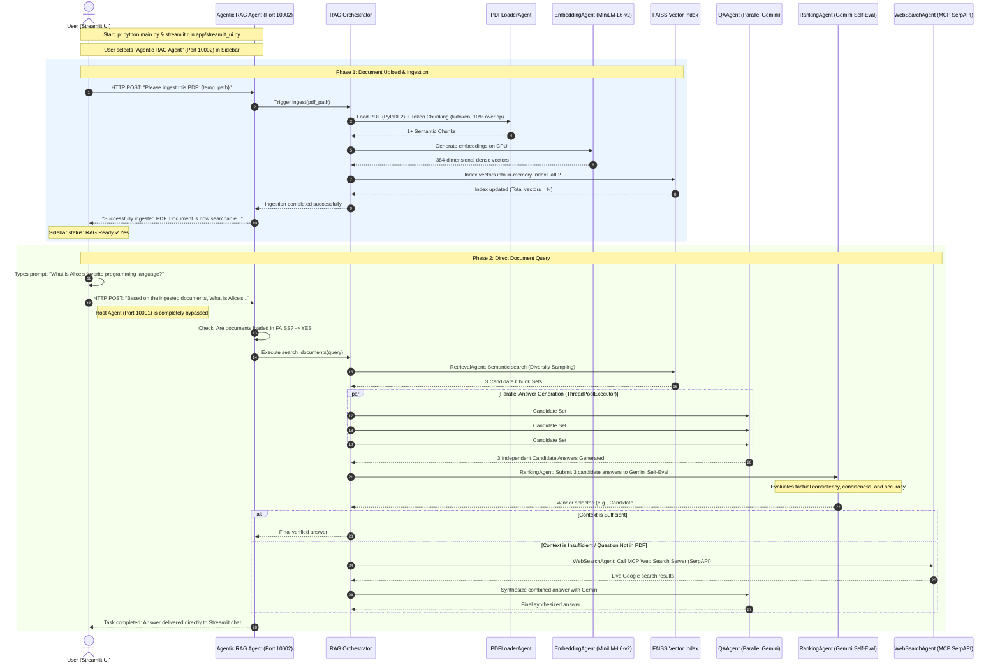

# Complete End-to-End System Flow: Direct Agentic RAG Agent Mode

This document details the step-by-step lifecycle of the system when you start the project, select the **Agentic RAG Agent** (Port `10002`) directly in the UI, upload a PDF, and query it.

---

## 1. High-Level Architecture Diagram (Direct RAG Mode)



---

## 2. Key Differences: Host Agent vs. RAG Agent Mode

| Feature | When "Host Agent" is Selected | When "Agentic RAG Agent" is Selected |
| :--- | :--- | :--- |
| **Direct Endpoint** | `http://127.0.0.1:10001` | `http://127.0.0.1:10002` |
| **Host Involvement** | Host orchestrates and delegates via A2A | **Host Agent is completely bypassed** |
| **Network Path** | User $\rightarrow$ Host Agent $\rightarrow$ A2A $\rightarrow$ RAG Agent | User $\rightarrow$ RAG Agent directly |
| **Prompt Enhancement** | User prompt sent as-is; Host detects intent | Streamlit automatically prefixes: `"Based on the ingested documents, <prompt>"` |
| **Latency** | Slightly higher (+1 A2A network hop) | Minimal (Direct connection to RAG engine) |
| **General Questions** | Host answers general questions, runs terminal, etc. | Focuses exclusively on document queries and deep RAG |

---

## 3. Phase-by-Phase Detailed Walkthrough

### Phase 1: Startup & Mode Selection

1. **Start System & UI**:
   ```powershell
   python main.py
   streamlit run app/streamlit_ui.py
   ```
2. **Select Agent**:
   - In the Streamlit sidebar dropdown, the user chooses **"Agentic RAG Agent"**.
   - Streamlit sets `agent_url = "http://127.0.0.1:10002/"`.
   - All subsequent chat messages and ingestion calls talk directly to Port `10002`.

---

### Phase 2: PDF Upload and Ingestion

1. **User Action**:
   - The user selects a PDF document (e.g. `sample_document.pdf`) in the sidebar and clicks **"Ingest PDF"**.

2. **File Handling (`app/streamlit_ui.py`)**:
   - The PDF is temporarily written to disk (`temp_path`).
   - Streamlit connects to `http://127.0.0.1:10002` and sends an A2A task:
     ```python
     message = f"Please ingest this PDF: {temp_path}"
     ```

3. **Ingestion Pipeline (`rag_orchestrator.py`)**:
   - **`PDFLoaderAgent`**:
     - Uses `PyPDF2.PdfReader` to extract all text page by page.
     - Calculates tokens with `tiktoken` (`cl100k_base`).
     - Splits text into chunks with 10% overlap to preserve cross-chunk context.
   - **`EmbeddingAgent`**:
     - Uses local HuggingFace `sentence-transformers/all-MiniLM-L6-v2`.
     - Generates 384-dimensional dense vector embeddings on CPU.
   - **`FAISS Index`**:
     - Vectors are added to an in-memory `IndexFlatL2` database.
   - **Return**:
     - Returns: `"Successfully ingested PDF: <path>. Document is now searchable..."`.
     - The temporary file is deleted.
     - Streamlit toggles `st.session_state.rag_agent_available = True`.

---

### Phase 3: Prompt Enhancement & Direct Dispatch

1. **User Query**:
   - The user enters a question in the chat input:
     > *"What is Alice's favorite programming language?"*

2. **Automatic Context Framing (`app/streamlit_ui.py`)**:
   - Because `selected_agent == "Agentic RAG Agent"` and `rag_agent_available == True`, Streamlit ensures document grounding:
     ```python
     if not any(word in prompt.lower() for word in ['document', 'resume', 'pdf', 'file', 'content']):
         enhanced_prompt = f"Based on the ingested documents, {prompt}"
     ```
   - Target prompt sent to Port `10002`:
     > *"Based on the ingested documents, What is Alice's favorite programming language?"*

---

### Phase 4: Inside the Agentic RAG Agent (`agents/agentic_rag_agent/agent.py`)

1. **Direct RAG Short-Circuit**:
   - In `AgenticRAGAgent.invoke()`:
     ```python
     rag_orch = self._get_rag_orchestrator()
     if rag_orch and rag_orch.retriever:
         print("[AgenticRAGAgent] Documents are loaded; querying directly via RAG orchestrator")
         result = await self.search_documents(query)
     ```
   - Because documents are loaded in memory, it directly calls `search_documents(query)` on the RAG Orchestrator, bypassing unnecessary intermediate steps.

2. **Diversity Retrieval (`RetrievalAgent`)**:
   - The query is embedded into a 384-d vector.
   - Queries FAISS and constructs **3 candidate sets** of top-ranked chunks (diversity sampling).

3. **Parallel Answer Generation (`QAAgent`)**:
   - Launches 3 concurrent threads via `ThreadPoolExecutor`.
   - Each thread queries **Google Gemini** (`gemini-3.1-flash-lite`) with a different candidate set.
   - Produces 3 candidate answers independently.

4. **Self-Evaluation & Ranking (`RankingAgent`)**:
   - Submits all 3 candidate answers to Gemini with the ranking rubric:
     > *"Evaluate candidate answers based on factual accuracy, conciseness, and alignment with the retrieved context. Select the best candidate and provide reasoning."*
   - Gemini self-evaluates and outputs:
     - **Selected Candidate**: (e.g. Candidate #1)
     - **Reason**: Explaining why this candidate was selected.
     - **Best Answer**: The exact final answer string.

5. **Intelligent Fallback Check (`_intelligent_route`)**:
   - Evaluates if the document context was sufficient:
     - **If yes**: Returns the selected answer immediately.
     - **If no** (the PDF does not contain the answer): Invokes `WebSearchAgent` via the MCP SerpAPI server to retrieve real-time internet context, synthesizes the answer, and returns it.

---

### Phase 5: Response Delivery

1. The RAG Executor creates a completion event:
   ```python
   await updater.update_status(
       TaskState.completed,
       new_agent_text_message(final_result, task.context_id, task.id)
   )
   ```
2. Streamlit receives the completed response directly from `http://127.0.0.1:10002`.
3. The answer is added to chat history and displayed to the user:
   > *"Alice's favorite programming language is Python."*

---

## 4. Special Direct Commands Supported by the RAG Agent

When connected directly to the RAG Agent, you can also query its built-in utility functions:

1. **Check RAG Status**:
   - Query: *"What is the system status?"* or click **"Check RAG Status"** in the sidebar.
   - Returns: Active chunk count, total indexed vectors in FAISS, active LLM model, and readiness state.
2. **Check Model Configuration**:
   - Query: *"What model configuration is active?"* or click **"Check Model Config"** in the sidebar.
   - Returns: Active LLM (`gemini-3.1-flash-lite`), Embedding model (`all-MiniLM-L6-v2`), provider information, and dimensions.
